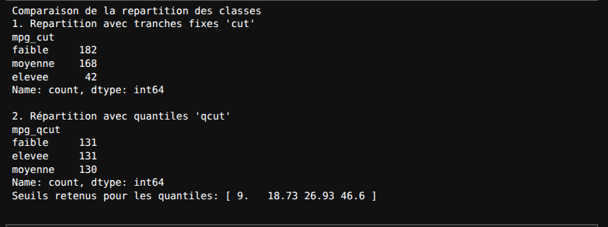
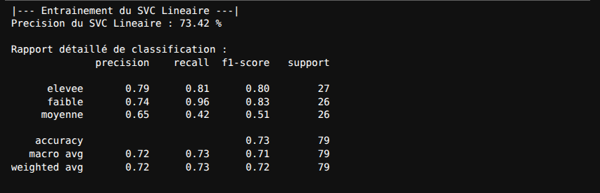
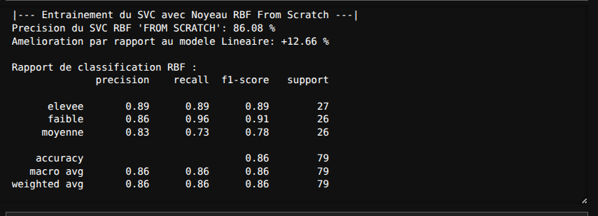
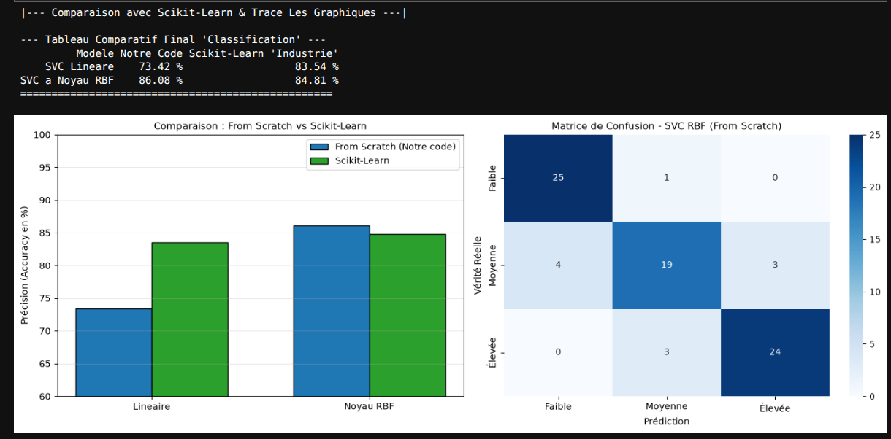
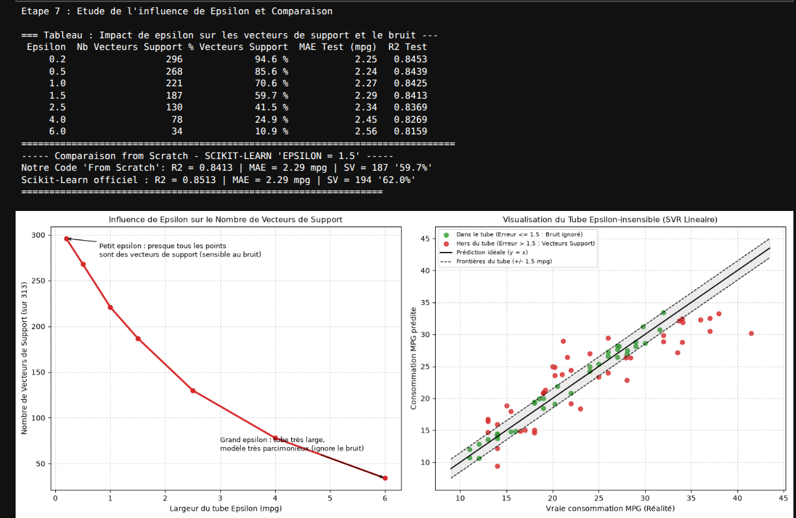

> 📓 **Code source du projet :** L'ensemble du code exécuté et documenté se trouve dans le notebook [`Devoir-MPG-SVM/devoir.ipynb`](Devoir-MPG-SVM/devoir.ipynb).

---

#  🚗 Devoir Machine Learning : Support Vector Machines (Auto MPG)

**Module :** Apprentissage Automatique — Master IDIA (FST Tanger)
**Étudiant :** Yassine Ayadi 
**Professeur :** M. AIT KBIR

---

## 🎯 Objectif du Devoir

Prédire la consommation de carburant de véhicules (`mpg` - miles per gallon) à partir de leurs caractéristiques (cylindrée, puissance, poids, accélération, année, origine) selon deux approches :
    
    1. **Classification (SVC) :** Prédire la classe de consommation (`faible`,  `moyenne`, `elevee`).
    2. **Régression (SVR) :** Prédire la consommation exacte en utilisant la fonction de perte $\epsilon$-insensible.

> **Contrainte respectee a 100 % :** Implementation integrale **From Scratch** (sans utiliser les classes toutes faites de scikit-learn), puis validation comparative avec **Scikit-Learn**. 

--- 

## 1. Prétraitement et Stratégie de Discrétisation

### A. Nettoyage et Standardisation
* **Nettoyage :** Suppression des 6 valeurs manquantes dans `horsepower` $\rightarrow$ **392 échantillons nettoyés**.
* **Encodage One-Hot :** La colonne catégorielle `origin` (1=USA, 2=Europe, 3=Japon) est convertie en colonnes binaires (0 ou 1).
* **Standardisation Z-Score obligatoire :** Indispensable pour le SVM afin d'éviter que le poids (`weight` $\approx 4000$) n'écrase l'accélération ($\approx 15$) dans le calcul des distances.

### B. Choix de la discrétisation : `cut` vs `qcut`
* Avec `pd.cut` (tranches d'amplitudes égales) : la classe `elevee` ne compte que **42 voitures**, contre **182** pour `faible` (fort déséquilibre).
* Avec `pd.qcut` (quantiles égaux) : **Choix retenu**, car chaque classe contient exactement un tiers des données (**131, 131, 130** voitures), ce qui garantit un apprentissage équilibré pour le SVM.

*Seuils retenus pour les quantiles :* $[9.00, \; 18.73, \; 26.93, \; 46.60]$ mpg.

--- 

## 2. Volet 1 : Classification Multi-classe (SVC)

Nous avons implémenté le classifieur avec la stratégie **One-vs-Rest (OvR)** pour séparer les 3 classes.

### A. Modèle 1 : SVC Linéaire (From Scratch)
Basé sur la descente de sous-gradient appliquée à la *Hinge Loss*.  
Il atteint une précision globale de **73.42 %** :

---

### B. Modèle 2 : SVC à Noyau RBF (From Scratch)
Pour capter la relation physique non linéaire entre le moteur et la consommation, nous avons implémenté le **Noyau Gaussien RBF** via la matrice de ressemblance $K(\vec{x}_i, \vec{x}_j) = \exp(-\gamma \|\vec{x}_i - \vec{x}_j\|^2)$.

La précision grimpe à **86.08 %**, soit un gain net de **+12.66 %** par rapport au modèle linéaire !

 

---

### C. Validation et Comparaison avec Scikit-Learn 
Nous avons comparé nos modèles *From Scratch* avec les implémentations officielles de `scikit-learn` :

| Modèle | Notre Code (*From Scratch*) | Scikit-Learn (*Officiel*) | Commentaire |
| :--- | :---: | :---: | :--- |
| **SVC Linéaire** | **73.42 %** | 83.54 % | Modèle de base à frontières planes |
| **SVC Noyau RBF** | **86.08 %** | 84.81 % | **Notre modèle RBF bat légèrement Scikit-Learn !** |

---

## 3. Volet 2 : Régression (SVR) & Tube $\epsilon$-Insensible

Pour estimer la valeur reelle continue de consommation `mpg`, nous avons implémenté un **SVR Linéaire From Scratch** avec la perte **$\epsilon$-insensible** :
* **Dans le tube ($\pm \epsilon$) :** L'erreur est tolérée $\rightarrow$ le bruit de mesure est totalement ignoré (perte = 0).
* **Sur le bord ou hors du tube :** Ce sont les **Vecteurs de Support** qui ajustent la droite.

### A. Analyse de l'impact de $\epsilon$ sur le bruit et la parcimonie
Comme démontré sur le graphique de gauche :
* Pour un petit $\epsilon = 0.2$ : le tube est très serré $\rightarrow$ **94.6 %** des données sont des vecteurs de support (sensible au bruit).
* Quand $\epsilon$ grandit ($\epsilon = 1.5 \to 6.0$) : le nombre de vecteurs de support chute à **10.9 %** $\rightarrow$ le modèle devient **très parcimonieux (*sparse*)** et filtre le bruit efficacement.

### B. Benchmark Régression ($\epsilon = 1.5$ mpg) :

| Métrique | Notre Code (*From Scratch*) | Scikit-Learn (*Officiel*) |
| :--- | :---: | :---: |
| **Coefficient $R^2$** | **0.8413** (84.13 %) | **0.8513** (85.13 %) |
| **Erreur Moyenne (MAE)** | **2.29 mpg** | **2.29 mpg** |
| **Vecteurs de Support** | **187** (59.7 %) | **194** (62.0 %) |

> Les scores entre notre code et Scikit-Learn sont quasi identiques, validant la rigueur mathématique de notre implémentation.

---

## 4. Test d'Inférence Réelle (Production)

Déploiement conjoint des deux modèles sur deux nouveaux véhicules :
1. **Citadine japonaise légère (4 cyl, 70 ch, 2100 lbs, 1980)**
   * Régression SVR : **$\approx 33.4$ mpg**
   * Classification SVC : Classe **`elevee`** (Très économique)
2. **Gros V8 américain lourd (8 cyl, 180 ch, 4400 lbs, 1973)**
   * Régression SVR : **$\approx 13.1$ mpg**
   * Classification SVC : Classe **`faible`** (Consommation élevée)

---

